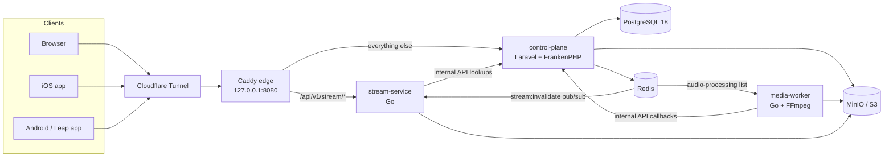

# Indie House - server

**English** · [Tiếng Việt](README.vi.md)

Indie House is a self-hosted, invite-only music streaming service for a small group of friends. It runs on a single homelab VM behind Cloudflare Tunnel. This repository holds the backend; the native clients are separate repositories:

| Repository | What |
| --- | --- |
| **indie-house-server** (this one) | Control plane (Laravel), media worker (Go), stream gateway (Go), deployment, documentation |
| [indie-house-ios](https://github.com/nphuly/indie-house-ios) | Native iOS 17+ client in SwiftUI |
| [indie-house-android](https://github.com/nphuly/indie-house-android) | Android 4.3 (API 18) client for the BlackBerry Leap, in Java with Android Views |

> **Disclaimer:** Indie House is provided as is, without warranty. If you host it, you alone are responsible for its security, for the rights to every track you upload and for complying with the law. It must not be used for pirated music or for commercial purposes. Read [DISCLAIMER.md](DISCLAIMER.md) (English · Tiếng Việt).
> 
> And because I worked best with GitLab, so I still leave the `.gitlab-ci.yml` here in this repo, in case you want to use it with GitLab CI/CD.

## Features

- **Listener web app** (Blade, Tailwind 4, Vite): browse the catalogue, search without diacritics and with small typos (PostgreSQL `unaccent` + `pg_trgm`), library, playlists, listening history, Vietnamese and English.
- **Admin** at `/admin` (Filament 5): artists, albums and tracks, invitations, roles, streaming access, mobile sessions, signing keys, backups.
- **Media pipeline**: uploads are transcoded by FFmpeg into constant-bitrate MP3 128/320, a 30-second guest preview, and 16-bit FLAC when the source is lossless.
- **Playback**: guests hear only the preview. Signed-in listeners pick MP3 128, MP3 320 or FLAC; lossless also needs a per-user grant.
- **Mobile JSON API** for the iOS and Android clients, with QR-code instance discovery (`/.well-known/indie-house`).
- **Operations**: encrypted backups (AES-256 zip) with restore, health checks, one-command deploys with rollback.

## Architecture



| Service | Path | Stack |
| --- | --- | --- |
| control-plane | `src/control-plane` | Laravel 13, Filament 5, Blade + Tailwind 4 + Vite, FrankenPHP (PHP 8.4), PostgreSQL 18, Redis |
| media-worker | `src/media-worker` | Go, FFmpeg, `metaflac` |
| stream-service | `src/stream-service` | Go |
| edge | `infrastructure/caddy` | Caddy |

Engineering notes:

- **A cross-language job contract.** Laravel pushes a JSON job onto an unprefixed Redis list. The Go worker pops it, downloads the upload from MinIO, transcodes it and reports each rendition back through an internal API that only the Go services can reach (`X-Internal-Key`, and a `404` at the edge).
- **No audio bytes through PHP.** For web playback Laravel checks the session, picks the quality and redirects (`302`) to a short-lived RS256 playback ticket served by the Go gateway. The browser never sees storage keys or presigned URLs.
- **The gateway holds no private keys.** stream-service verifies JWTs with the public key only, resolves object keys through the control plane (it never connects to PostgreSQL), caches lookups, and drops cached entries when the control plane publishes on `stream:invalidate`. It proxies MinIO with `Range` support and rate-limits per user through Redis, failing closed when Redis is down.
- **Mobile auth.** RS256 access tokens and rotating refresh tokens, stored hashed. Reusing an old refresh token revokes the whole session. Signing keys can be rotated from the admin panel.
- **Hardening.** A nonce-based Content-Security-Policy, HSTS, per-visitor rate limits from Cloudflare's client IP header, and a password change that signs out every other session.
- **Deploys you can roll back.** `infrastructure/scripts/deploy-release.sh` dumps the database, runs migrations, swaps the containers, waits for health checks and moves the image tags back if the rollout fails. Migrations therefore have to stay compatible with the version that is already running.

Read more in [Architecture](docs/en/architecture.md) and [Playback and streaming](docs/en/playback.md).

## Running it locally

You need Docker, Node.js 22 (Vite runs on the host) and, to upload tracks, an S3-compatible bucket such as MinIO.

```bash
cp .env.example .env            # fill it in: see docs/en/local-development.md
make build
make start                      # control-plane on :80, PostgreSQL and Redis on loopback
make composer-install
make migrate
make create-super-admin         # interactive, then sign in at /admin
cd src/control-plane && npm ci && npm run dev
```

The full walkthrough, including signing keys and the demo catalogue, is in [Local development](docs/en/local-development.md).

## Tests

```bash
make test                                   # Laravel suite in the development container (in-memory SQLite)
cd src/stream-service && go test ./...
cd src/media-worker && go test ./...
sh infrastructure/scripts/test-deploy-release.sh
```

## Deployment

The production instance runs on a Proxmox VM. `.gitlab-ci.yml` comes from the original GitLab setup: on protected `release/X.Y[.Z]` branches it lints and tests everything, builds three images with rootless BuildKit, and offers a manual deploy job that SSHes to the VM and runs the deploy script. You can also build the images on the server by hand. See [Deployment](docs/en/deployment.md).

## Documentation

The documentation is available in [English](docs/en/README.md) and [Vietnamese](docs/vi/README.md):

| Topic | |
| --- | --- |
| [Architecture](docs/en/architecture.md) | Components, routing, media pipeline, contracts between services |
| [Local development](docs/en/local-development.md) | Setting up, tests, conventions |
| [Deployment](docs/en/deployment.md) | Hosting an instance with Docker and Cloudflare Tunnel |
| [Configuration](docs/en/configuration.md) | Every environment variable |
| [Operations](docs/en/operations.md) | Admin tasks, access control, key rotation, monitoring |
| [Backup and restore](docs/en/backup-and-restore.md) | Encrypted backups and restore drills |
| [Playback and streaming](docs/en/playback.md) | Renditions, quality, playback tickets, the gateway |
| [Mobile API](docs/en/mobile-api.md) | Discovery, authentication, endpoints |
| [Security](docs/en/security.md) | Security model, known limitations, reporting |
| [Privacy](docs/en/privacy.md) | What an instance stores, legal pages |
| [Design system](docs/en/design-system.md) | The "Biển hiệu" visual language shared by web and apps |

## License

[PolyForm Noncommercial License 1.0.0](LICENSE). You may read, run and modify the code for any noncommercial purpose. Commercial use is not permitted. This is a source-available license, not an OSI open-source license.
