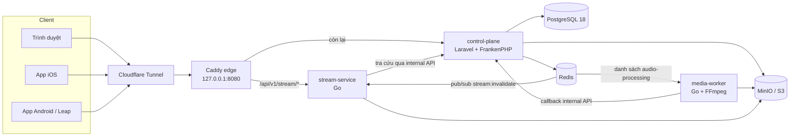

# Indie House — server

[English](README.md) · **Tiếng Việt**

Indie House là dịch vụ nghe nhạc tự host, chỉ dành cho người được mời, phục vụ một nhóm bạn nhỏ. Dịch vụ chạy trên một VM trong homelab, phía sau Cloudflare Tunnel. Repo này chứa phần backend; các app native nằm ở repo riêng:

| Repo | Nội dung |
| --- | --- |
| **indie-house-server** (repo này) | Control plane (Laravel), media worker (Go), stream gateway (Go), triển khai, tài liệu |
| [indie-house-ios](https://github.com/nphuly/indie-house-ios) | App iOS 17+ native viết bằng SwiftUI |
| [indie-house-android](https://github.com/nphuly/indie-house-android) | App Android 4.3 (API 18) cho BlackBerry Leap, viết bằng Java và Android Views |

> **Miễn trừ trách nhiệm:** Indie House được cung cấp nguyên trạng, không kèm bảo đảm. Nếu bạn tự host, bạn tự chịu trách nhiệm về an toàn, về quyền đối với mọi bài nhạc bạn tải lên và về việc tuân thủ pháp luật. Không được dùng cho nhạc lậu hay mục đích thương mại. Đọc [DISCLAIMER.md](DISCLAIMER.md#tiếng-việt).
>
> Và bởi vì tôi đã quen làm việc với GitLab, nên tôi vẫn sẽ để nguyên file `.gitlab-ci.yml` ở đây, phòng khi bạn cần đến nó để xài với GitLab CI/CD!

## Tính năng

- **Web nghe nhạc** (Blade, Tailwind 4, Vite): duyệt catalogue, tìm kiếm không cần gõ dấu và chấp nhận lỗi gõ nhỏ (PostgreSQL `unaccent` + `pg_trgm`), thư viện, playlist, lịch sử nghe, tiếng Việt và tiếng Anh.
- **Trang quản trị** tại `/admin` (Filament 5): nghệ sĩ, album và bài hát, lời mời, role, quyền stream, phiên mobile, khoá ký, sao lưu.
- **Xử lý media**: file upload được FFmpeg chuyển thành MP3 128/320 bitrate cố định, một bản nghe thử 30 giây cho khách, và FLAC 16-bit khi nguồn là lossless.
- **Phát nhạc**: khách chỉ nghe bản thử. Người nghe đã đăng nhập chọn MP3 128, MP3 320 hoặc FLAC; lossless cần được cấp quyền theo từng người.
- **Mobile JSON API** cho app iOS và Android, kèm cơ chế tìm instance bằng mã QR (`/.well-known/indie-house`).
- **Vận hành**: sao lưu mã hoá (zip AES-256) có khôi phục, kiểm tra sức khoẻ, deploy bằng một lệnh và tự rollback khi lỗi.

## Kiến trúc



| Service | Đường dẫn | Công nghệ |
| --- | --- | --- |
| control-plane | `src/control-plane` | Laravel 13, Filament 5, Blade + Tailwind 4 + Vite, FrankenPHP (PHP 8.4), PostgreSQL 18, Redis |
| media-worker | `src/media-worker` | Go, FFmpeg, `metaflac` |
| stream-service | `src/stream-service` | Go |
| edge | `infrastructure/caddy` | Caddy |

Điểm đáng chú ý về kỹ thuật:

- **Contract job giữa hai ngôn ngữ.** Laravel đẩy một job JSON vào danh sách Redis không có prefix. Worker Go lấy job, tải file từ MinIO, chuyển mã, rồi báo từng rendition qua một internal API mà chỉ service Go gọi được (`X-Internal-Key`, và edge trả `404`).
- **Không có byte audio nào đi qua PHP.** Khi phát trên web, Laravel kiểm tra session, chọn chất lượng rồi redirect (`302`) sang một vé phát RS256 ngắn hạn do gateway Go phục vụ. Trình duyệt không bao giờ thấy key trong storage hay presigned URL.
- **Gateway không giữ private key.** stream-service chỉ kiểm tra JWT bằng public key, tra key của object qua control plane (không bao giờ kết nối PostgreSQL), cache kết quả, và xoá cache khi control plane gửi tin trên `stream:invalidate`. Gateway proxy MinIO có hỗ trợ `Range` và giới hạn tần suất theo user qua Redis, từ chối request khi Redis không hoạt động.
- **Xác thực mobile.** Access token RS256 và refresh token xoay vòng, lưu dạng băm. Dùng lại một refresh token cũ sẽ thu hồi cả phiên. Khoá ký xoay được từ trang quản trị.
- **Tăng cứng.** Content-Security-Policy dùng nonce, HSTS, giới hạn tần suất theo từng người dựa trên header IP của Cloudflare, và đổi mật khẩu sẽ đăng xuất mọi phiên khác.
- **Deploy có thể rollback.** `infrastructure/scripts/deploy-release.sh` dump database, chạy migration, thay container, đợi health check và trả tag image về bản cũ nếu rollout lỗi. Vì vậy migration phải tương thích với phiên bản đang chạy.

Đọc thêm ở [Kiến trúc](docs/vi/architecture.md) và [Phát nhạc và streaming](docs/vi/playback.md).

## Chạy trên máy

Bạn cần Docker, Node.js 22 (Vite chạy trên máy) và, khi muốn upload bài hát, một bucket tương thích S3 như MinIO.

```bash
cp .env.example .env            # điền theo docs/vi/local-development.md
make build
make start                      # control-plane ở cổng 80, PostgreSQL và Redis chỉ trên loopback
make composer-install
make migrate
make create-super-admin         # hỏi thông tin tương tác, rồi đăng nhập ở /admin
cd src/control-plane && npm ci && npm run dev
```

Hướng dẫn đầy đủ, gồm khoá ký và catalogue demo, có trong [Phát triển local](docs/vi/local-development.md).

## Kiểm thử

```bash
make test                                   # bộ test Laravel trong container development (SQLite in-memory)
cd src/stream-service && go test ./...
cd src/media-worker && go test ./...
sh infrastructure/scripts/test-deploy-release.sh
```

## Triển khai

Instance production chạy trên một VM Proxmox. `.gitlab-ci.yml` là pipeline từ thiết lập GitLab ban đầu: trên branch được bảo vệ `release/X.Y[.Z]`, pipeline kiểm tra và chạy test mọi thứ, build ba image bằng BuildKit rootless, và có job deploy chạy tay để SSH vào VM chạy script deploy. Bạn cũng có thể build image ngay trên máy chủ. Xem [Triển khai](docs/vi/deployment.md).

## Tài liệu

Tài liệu có bản [tiếng Anh](docs/en/README.md) và [tiếng Việt](docs/vi/README.md):

| Chủ đề | |
| --- | --- |
| [Kiến trúc](docs/vi/architecture.md) | Thành phần, định tuyến, xử lý media, contract giữa các service |
| [Phát triển local](docs/vi/local-development.md) | Cài đặt, kiểm thử, quy ước |
| [Triển khai](docs/vi/deployment.md) | Host một instance bằng Docker và Cloudflare Tunnel |
| [Cấu hình](docs/vi/configuration.md) | Mọi biến môi trường |
| [Vận hành](docs/vi/operations.md) | Việc quản trị, phân quyền, xoay khoá, giám sát |
| [Sao lưu và khôi phục](docs/vi/backup-and-restore.md) | Sao lưu mã hoá và diễn tập khôi phục |
| [Phát nhạc và streaming](docs/vi/playback.md) | Rendition, chất lượng, vé phát, gateway |
| [Mobile API](docs/vi/mobile-api.md) | Tìm instance, xác thực, endpoint |
| [Bảo mật](docs/vi/security.md) | Mô hình bảo mật, giới hạn đã biết, báo lỗ hổng |
| [Quyền riêng tư](docs/vi/privacy.md) | Instance lưu gì, trang pháp lý |
| [Hệ thiết kế](docs/vi/design-system.md) | Ngôn ngữ hình ảnh "Biển hiệu" dùng chung cho web và app |

## Giấy phép

[PolyForm Noncommercial License 1.0.0](LICENSE). Bạn được đọc, chạy và sửa mã nguồn cho mọi mục đích phi thương mại. Không được dùng cho mục đích thương mại. Đây là giấy phép source-available, không phải giấy phép mã nguồn mở theo định nghĩa của OSI.
