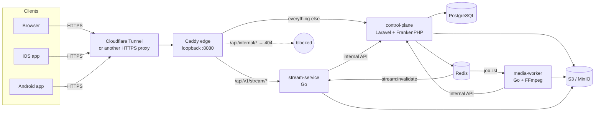
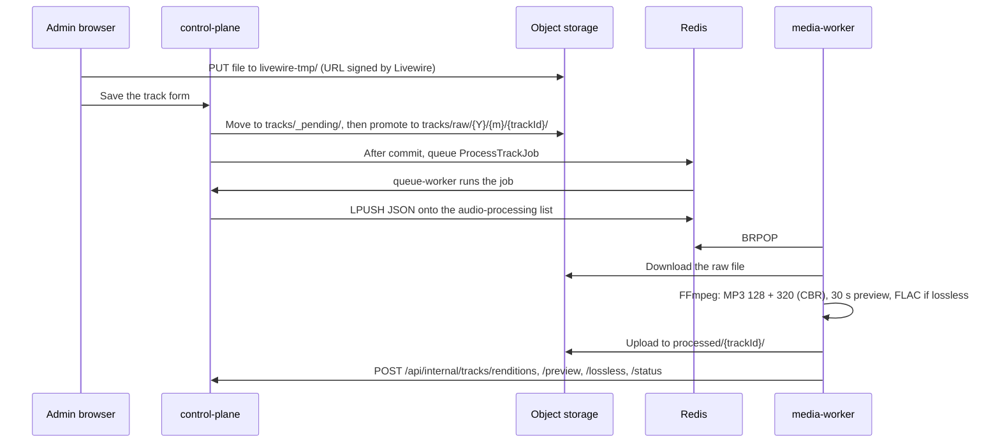

# Architecture

**English** · [Tiếng Việt](../vi/architecture.md)

Indie House runs as a handful of containers on one host. A Laravel application owns all data and decisions; two small Go services do the heavy lifting for media.



## Components

| Component | Role |
| --- | --- |
| **edge** (Caddy) | The only port published on the host, bound to loopback. Routes requests, sets the forwarded scheme and client IP, and hides the internal API. |
| **control-plane** (Laravel 13, FrankenPHP) | Source of truth. Serves the listener web app, the Filament admin panel (`/admin`), the mobile JSON API and the internal API. Signs every token. |
| **queue-worker** | Same image as the control plane, running `queue:work` for Laravel jobs (dispatching media jobs, backups, deleting objects). |
| **scheduler** | Same image, running `schedule:work`: nightly cleanup of abandoned uploads and the backup schedule set in the admin panel. |
| **media-worker** (Go) | Pops jobs from Redis, downloads the uploaded file, transcodes it with FFmpeg and reports the results back. |
| **stream-service** (Go) | The audio gateway for the web and both apps. Verifies tokens, rate-limits, and proxies audio from object storage with `Range` support. |
| **PostgreSQL 18** | Accounts, catalogue, playlists, play history, mobile sessions, settings, backup records. |
| **Redis 8** | Laravel queue, web sessions, cache and rate limits; the media job list; the cache invalidation channel. Runs with AOF persistence. |
| **Object storage** | Any S3-compatible service (the reference deployment uses MinIO). Holds uploads, renditions, artwork and avatars. The bucket stays private. |

## Request routing

The edge (`infrastructure/caddy/Caddyfile`) has three rules:

1. `/api/internal` and `/api/internal/*` answer `404`. The Go services reach the internal API directly on the Compose network, so nothing from the Internet can.
2. `/api/v1/stream/*` goes to the gateway with the prefix stripped.
3. Everything else goes to the control plane.

The edge sets `X-Forwarded-Proto` from `PUBLIC_SCHEME` and replaces `X-Forwarded-For` with the visitor address that Cloudflare sends in `Cf-Connecting-Ip`. Laravel trusts only those two headers and never a forwarded host, so per-IP rate limits count each visitor separately. Because anyone who can reach the edge directly could forge `Cf-Connecting-Ip`, the edge listens on loopback only.

Web, admin, API and audio all live on **one HTTPS origin**. `APP_URL`, `INSTANCE_BASE_URL` and the JWT issuer must be that same origin; clients discover it through `GET /.well-known/indie-house`.

## Three ways in

| Surface | Routes | Authentication |
| --- | --- | --- |
| Web | `routes/web.php`, `/admin` | Laravel session cookie. Changing the password signs out every other browser session. Admin access uses roles (`super_admin`, `admin`, `user`). |
| Mobile API | `/api/v1/mobile/*` | RS256 access JWT in `Authorization: Bearer`, plus rotating refresh tokens. See [Mobile API](mobile-api.md). |
| Internal API | `/api/internal/*` | `X-Internal-Key` header equal to `INTERNAL_API_KEY`. Only the Go services call it; the edge blocks it from outside. |

## Catalogue model

- **Tracks** (UUID keys) belong to an artist and can appear on albums. **Artists** and **albums** use integer keys. **Playlists** use UUIDs.
- Everything shown publicly is addressed by a 12-character `public_id`. Internal keys never leave the server.
- A track is public only when `is_published = true` **and** `status = 'completed'`. Every listener query, web or mobile, goes through `Track::scopePublicCatalogue()`, including eager loads through albums, artists and playlists, so a draft or failed track never leaks.
- Each track has **renditions**: `mp3_128`, `mp3_320`, `preview_30` and, for lossless sources, `lossless` (FLAC). Older tracks may also have `hls_128`/`hls_320`, which are kept but no longer produced.
- Play counts are never set by clients. The server records a play once per playback session and increments the count only for completed plays.

## Upload and processing



- The admin form accepts FLAC, WAV and MP3 up to 500 MiB.
- File promotion copies first, fails loudly if storage refuses, and deletes the pending copy only after the database commit. If anything fails, the record is rolled back and the admin sees a notification.
- Uploads abandoned in `livewire-tmp/` or `tracks/_pending/` for more than 24 hours are removed by the nightly `media:purge-pending-uploads`.
- MP3 renditions are constant bitrate. The FLAC rendition is 16-bit/44.1 kHz with seek points, made only when `ffprobe` reports a lossless source. See [Playback and streaming](playback.md) for the formats.

### The media job contract

The job is a JSON object pushed onto an **unprefixed** Redis list (connection `media_worker`, list name from `services.media_worker.queue`, default `audio-processing`):

```json
{"track_id": "uuid", "raw_file_key": "tracks/raw/2026/10/uuid/file.flac", "title": "…", "artist_id": 1, "attempt": 0}
```

Backfill jobs add `"kind": "preview_backfill"` (build only the preview) or `"kind": "lossless_backfill"` (build only the FLAC, skip lossy sources); neither changes the track status. The worker accepts only UUID track IDs and a fixed list of audio extensions, and runs FFmpeg with `-protocol_whitelist file`.

The worker answers through four internal endpoints: `tracks/status`, `tracks/renditions`, `tracks/preview` and `tracks/lossless`. The job payload and the callback bodies are a contract between PHP and Go: change both sides together.

## Playback in one paragraph

Laravel decides *who* may hear *what* at *which quality*; the gateway moves the bytes. Browsers get a short-lived playback ticket through a same-origin redirect; apps send their access token. The gateway asks the control plane which object to serve, caches the answer, and streams it from storage with `Range` support. The browser never sees a storage key or a presigned URL. Details: [Playback and streaming](playback.md).

## Contracts between services

| Contract | Producer → consumer | Where |
| --- | --- | --- |
| Media job JSON | `ProcessTrackJob`, backfill commands → media-worker | Redis list `audio-processing` |
| Processing callbacks | media-worker → control plane | `POST /api/internal/tracks/*` |
| Asset lookup | gateway → control plane | `GET /api/internal/stream/tracks/{publicId}/asset` |
| Cache invalidation | `StreamCacheObserver` → gateway | Redis channel `stream:invalidate` (unprefixed) |
| JWT claims | control plane → gateway, apps | RS256, `token_use` = `access` or `playback` |

## Design decisions

- **The Go services never connect to PostgreSQL.** The control plane is the only place that knows whether a track is visible or a user may hear lossless. The gateway asks over the internal API and caches the answer. This keeps database credentials out of the gateway and keeps one source of truth.
- **The gateway holds public keys only.** It can verify tokens but never mint them.
- **No audio through PHP in production.** PHP checks permissions and redirects; Go streams. Development, which has no edge, lets Laravel stream (`STREAM_WEB_AUDIO_VIA_GATEWAY=false`).
- **One origin.** A single HTTPS hostname keeps cookies, CORS, token audiences and client configuration simple, and stops a token from being sent to another instance's gateway.
- **Migrations stay compatible with the running release.** The deploy script migrates *before* swapping containers and does not reverse migrations on rollback, so the previous release must keep working against the new schema.
- **Runtime settings live in the database.** Backup schedules and similar options are edited in the admin panel and read through `App\Support\Settings`, cached per group.
