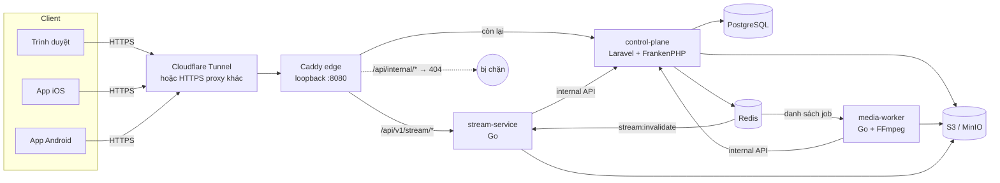
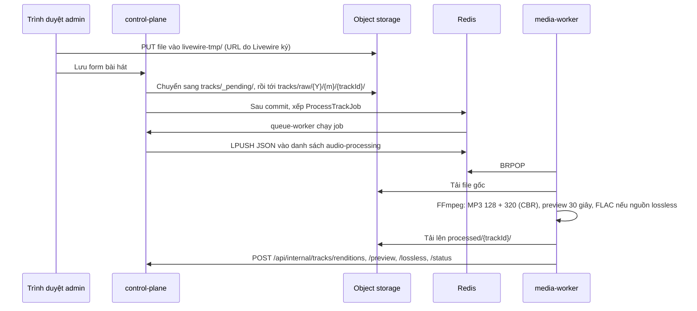

# Kiến trúc

[English](../en/architecture.md) · **Tiếng Việt**

Indie House chạy dưới dạng vài container trên một máy. Ứng dụng Laravel giữ toàn bộ dữ liệu và quyết định; hai service Go nhỏ lo phần nặng về media.



## Thành phần

| Thành phần | Vai trò |
| --- | --- |
| **edge** (Caddy) | Cổng duy nhất được publish ra máy chủ, chỉ bind loopback. Định tuyến request, đặt scheme và IP người dùng, chặn internal API. |
| **control-plane** (Laravel 13, FrankenPHP) | Nguồn sự thật. Phục vụ web nghe nhạc, trang quản trị Filament (`/admin`), mobile JSON API và internal API. Ký mọi token. |
| **queue-worker** | Cùng image với control plane, chạy `queue:work` cho các job Laravel (đẩy job media, sao lưu, xoá object). |
| **scheduler** | Cùng image, chạy `schedule:work`: dọn file upload bỏ dở mỗi đêm và chạy lịch sao lưu đặt trong trang quản trị. |
| **media-worker** (Go) | Lấy job từ Redis, tải file upload về, chuyển mã bằng FFmpeg rồi báo kết quả lại. |
| **stream-service** (Go) | Cổng audio cho web và hai app. Kiểm tra token, giới hạn tần suất, proxy audio từ object storage có hỗ trợ `Range`. |
| **PostgreSQL 18** | Tài khoản, catalogue, playlist, lịch sử nghe, phiên mobile, cài đặt, bản ghi sao lưu. |
| **Redis 8** | Queue Laravel, session web, cache và giới hạn tần suất; danh sách job media; kênh xoá cache. Chạy với AOF. |
| **Object storage** | Bất kỳ dịch vụ tương thích S3 nào (bản triển khai tham chiếu dùng MinIO). Chứa file upload, rendition, artwork, ảnh đại diện. Bucket luôn private. |

## Định tuyến request

Edge (`infrastructure/caddy/Caddyfile`) có ba luật:

1. `/api/internal` và `/api/internal/*` trả `404`. Service Go gọi internal API trực tiếp trong mạng Compose, nên từ Internet không ai gọi được.
2. `/api/v1/stream/*` chuyển tới gateway, bỏ tiền tố.
3. Mọi thứ còn lại chuyển tới control plane.

Edge đặt `X-Forwarded-Proto` theo `PUBLIC_SCHEME` và ghi đè `X-Forwarded-For` bằng địa chỉ người dùng mà Cloudflare gửi trong `Cf-Connecting-Ip`. Laravel chỉ tin hai header này, không bao giờ tin forwarded host, nên giới hạn tần suất theo IP tính riêng từng người. Ai gọi thẳng được edge cũng giả được `Cf-Connecting-Ip`, vì vậy edge chỉ nghe trên loopback.

Web, admin, API và audio dùng chung **một HTTPS origin**. `APP_URL`, `INSTANCE_BASE_URL` và issuer của JWT phải là đúng origin đó; client tìm ra nó qua `GET /.well-known/indie-house`.

## Ba lối vào

| Lối vào | Route | Xác thực |
| --- | --- | --- |
| Web | `routes/web.php`, `/admin` | Cookie session Laravel. Đổi mật khẩu sẽ đăng xuất mọi phiên trình duyệt khác. Quyền vào admin theo role (`super_admin`, `admin`, `user`). |
| Mobile API | `/api/v1/mobile/*` | Access JWT RS256 trong `Authorization: Bearer`, cùng refresh token xoay vòng. Xem [Mobile API](mobile-api.md). |
| Internal API | `/api/internal/*` | Header `X-Internal-Key` bằng `INTERNAL_API_KEY`. Chỉ service Go gọi; edge chặn từ bên ngoài. |

## Mô hình catalogue

- **Bài hát** (khoá UUID) thuộc một nghệ sĩ và có thể nằm trong album. **Nghệ sĩ** và **album** dùng khoá số nguyên. **Playlist** dùng UUID.
- Mọi thứ hiện công khai đều định danh bằng `public_id` 12 ký tự. Khoá nội bộ không bao giờ ra khỏi server.
- Một bài chỉ công khai khi `is_published = true` **và** `status = 'completed'`. Mọi truy vấn phía người nghe, web hay mobile, đều đi qua `Track::scopePublicCatalogue()`, kể cả eager load qua album, nghệ sĩ và playlist, nên bài nháp hoặc bài lỗi không bao giờ lộ ra.
- Mỗi bài có các **rendition**: `mp3_128`, `mp3_320`, `preview_30` và, với nguồn lossless, `lossless` (FLAC). Bài cũ có thể còn `hls_128`/`hls_320`; chúng được giữ nhưng không còn được tạo mới.
- Client không bao giờ tự đặt số lượt nghe. Server ghi một lượt cho mỗi phiên phát và chỉ tăng số đếm khi nghe hết bài.

## Upload và xử lý



- Form admin nhận FLAC, WAV và MP3, tối đa 500 MiB.
- Khi chuyển file, hệ thống chép trước, báo lỗi ngay nếu storage từ chối, và chỉ xoá bản tạm sau khi database commit. Có lỗi thì bản ghi được rollback và admin thấy thông báo.
- File bị bỏ dở trong `livewire-tmp/` hoặc `tracks/_pending/` quá 24 giờ sẽ bị `media:purge-pending-uploads` xoá vào mỗi đêm.
- Rendition MP3 có bitrate cố định. Rendition FLAC là 16-bit/44,1 kHz có điểm tua, chỉ được tạo khi `ffprobe` thấy nguồn lossless. Định dạng chi tiết ở [Phát nhạc và streaming](playback.md).

### Contract của job media

Job là một object JSON được đẩy vào danh sách Redis **không có prefix** (connection `media_worker`, tên danh sách lấy từ `services.media_worker.queue`, mặc định `audio-processing`):

```json
{"track_id": "uuid", "raw_file_key": "tracks/raw/2026/10/uuid/file.flac", "title": "…", "artist_id": 1, "attempt": 0}
```

Job bổ sung có thêm `"kind": "preview_backfill"` (chỉ tạo preview) hoặc `"kind": "lossless_backfill"` (chỉ tạo FLAC, bỏ qua nguồn lossy); cả hai đều không đổi trạng thái bài. Worker chỉ nhận track ID dạng UUID và một danh sách đuôi file audio cố định, và chạy FFmpeg với `-protocol_whitelist file`.

Worker trả lời qua bốn endpoint nội bộ: `tracks/status`, `tracks/renditions`, `tracks/preview` và `tracks/lossless`. Payload của job và body của các callback là contract giữa PHP và Go: đổi thì đổi cả hai bên cùng lúc.

## Phát nhạc trong một đoạn

Laravel quyết định *ai* được nghe *bài gì* ở *chất lượng nào*; gateway chuyển byte. Trình duyệt nhận một vé phát ngắn hạn qua redirect cùng origin; app gửi access token của mình. Gateway hỏi control plane cần phục vụ object nào, cache câu trả lời, rồi stream từ storage có hỗ trợ `Range`. Trình duyệt không bao giờ thấy key trong storage hay presigned URL. Chi tiết: [Phát nhạc và streaming](playback.md).

## Contract giữa các service

| Contract | Bên gửi → bên nhận | Ở đâu |
| --- | --- | --- |
| JSON job media | `ProcessTrackJob`, lệnh backfill → media-worker | Danh sách Redis `audio-processing` |
| Callback xử lý | media-worker → control plane | `POST /api/internal/tracks/*` |
| Tra cứu asset | gateway → control plane | `GET /api/internal/stream/tracks/{publicId}/asset` |
| Xoá cache | `StreamCacheObserver` → gateway | Kênh Redis `stream:invalidate` (không prefix) |
| Claim JWT | control plane → gateway, app | RS256, `token_use` là `access` hoặc `playback` |

## Các quyết định thiết kế

- **Service Go không bao giờ kết nối PostgreSQL.** Chỉ control plane biết một bài có công khai không hay một người có được nghe lossless không. Gateway hỏi qua internal API và cache câu trả lời. Nhờ vậy gateway không giữ credential database, và chỉ có một nguồn sự thật.
- **Gateway chỉ giữ public key.** Nó kiểm tra được token nhưng không tạo được token.
- **Production không cho audio đi qua PHP.** PHP kiểm tra quyền rồi redirect; Go stream. Development không có edge nên để Laravel tự stream (`STREAM_WEB_AUDIO_VIA_GATEWAY=false`).
- **Một origin.** Một hostname HTTPS duy nhất giữ cookie, CORS, audience của token và cấu hình client đơn giản, và chặn việc token bị gửi tới gateway của instance khác.
- **Migration tương thích với bản đang chạy.** Script deploy chạy migration *trước* khi thay container và không đảo ngược migration khi rollback, nên bản trước vẫn phải chạy được trên schema mới.
- **Cài đặt runtime nằm trong database.** Lịch sao lưu và các tuỳ chọn tương tự được sửa trong trang quản trị và đọc qua `App\Support\Settings`, cache theo nhóm.
